# City Sense — Frontend

The City Sense frontend is a role-based web application for accessing city services. Citizens can browse services, submit and track requests, and pay for paid services. Resolvers can manage assignments, while administrators manage requests, users, resolver applications, and the service catalog.

This package contains the Next.js client only. It communicates with the City Sense API in the sibling `server/` project; the API owns authentication, authorization, workflow rules, persistence, and payment processing.

## Contents

- [Features](#features)
- [Technology](#technology)
- [Application routes](#application-routes)
- [Architecture and data flow](#architecture-and-data-flow)
- [Requirements](#requirements)
- [Run with Docker Compose](#run-with-docker-compose)
- [Run the client directly](#run-the-client-directly)
- [Configuration](#configuration)
- [API and authentication behavior](#api-and-authentication-behavior)
- [Project layout](#project-layout)
- [Development scripts](#development-scripts)
- [Troubleshooting](#troubleshooting)

## Features

### Public and account flows

- Public landing page and information pages for City Sense, services, FAQs, and contact details.
- Email/password sign-in and registration, account verification, password recovery, and Google sign-in.
- Shared loading, error, not-found, and payment result screens.

### Citizen workspace

- Dashboard, profile editing, and service catalog browsing.
- Creation of complaints and service requests with location details and optional attachments.
- Request lists and request detail views, including status history and feedback actions.
- Payment initiation and confirmation for paid services, with success and cancellation return pages.

### Resolver workspace

- Assignment dashboard and assignment list/detail views.
- Resolver application entry point from the public site.
- Assignment actions and work progress updates through the API.

### Administrator workspace

- Overview dashboard, request and user management.
- Resolver application review.
- Service and service-category catalog management.

The UI exposes workflows implemented by the backend. Available actions and data are subject to the signed-in user's role, account state, and the API's current workflow rules.

## Technology

| Technology | Use |
| --- | --- |
| Next.js 16 App Router | Routing, layouts, error boundaries, and production server build. |
| React 19 and TypeScript | UI and typed application code. |
| Tailwind CSS v4 | Utility styling, with PostCSS integration. |
| shadcn components (`base-nova`) and Base UI | Reusable accessible interface primitives. |
| TanStack Query | API query caching, mutations, and client-side server state. |
| TanStack Form and Zod | Form state and input validation. |
| ofetch | HTTP client used by the API modules. |
| Biome | Linting and formatting. |
| Bun | Package manager and runtime used by the project and Docker image. |

## Application routes

Routes are organized with Next.js route groups. Parenthesized group names organize files without becoming URL segments.

| URL | Audience | Purpose |
| --- | --- | --- |
| `/` | Public | Landing page. |
| `/about`, `/service`, `/faq`, `/contact` | Public | Marketing and service information. |
| `/auth` | Public | Sign in and registration. |
| `/verify-account` | Public | Email verification. |
| `/dashboard` | Citizen | Citizen overview. |
| `/dashboard/services` | Citizen | Browse services. |
| `/dashboard/requests/new` | Citizen | Submit a complaint or service request. |
| `/dashboard/my-requests` | Citizen | View the citizen's requests. |
| `/dashboard/my-requests/[id]` | Citizen | View a request, its progress, and related payment or feedback actions. |
| `/dashboard/profile` | Signed-in user | Profile page in the citizen workspace. |
| `/resolver` | Resolver | Resolver overview. |
| `/resolver/assignments` | Resolver | List assignments. |
| `/resolver/assignments/[id]` | Resolver | Assignment details and available work actions. |
| `/admin` | Administrator | Administration overview. |
| `/admin/requests`, `/admin/requests/[id]` | Administrator | Review and manage requests. |
| `/admin/resolver-applications` | Administrator | Review resolver applications. |
| `/admin/users` | Administrator | Manage users. |
| `/admin/services`, `/admin/categories` | Administrator | Manage the service catalog. |
| `/payment/success`, `/payment/cancel` | Payment return | Display the outcome of a payment redirect. |

Authentication and role guard components protect relevant areas of the dashboard. The server remains the authority for permissions; hiding or guarding a client route is not a replacement for API authorization.

## Architecture and data flow

```mermaid
flowchart LR
    Browser[Browser] --> App[Next.js App Router]
    App --> Pages[Pages and layouts]
    Pages --> Hooks[TanStack Query hooks]
    Hooks --> Modules[Resource API modules]
    Modules --> Client[ofetch API client]
    Client -->|credentials included| API[City Sense API /api/v1]
    API --> Services[Backend services]
```



The main frontend flow is:

1. A route renders a page and its shared layouts or guards.
2. Pages use feature hooks in `src/hooks/` for query and mutation state.
3. Hooks call resource functions in `src/api/`. Endpoint paths are kept in these modules.
4. Resource functions use the shared `src/lib/apiClient.ts`, which targets `NEXT_PUBLIC_API_BASE_URL`.
5. The API returns the standard envelope. Hooks and pages consume the response data while retaining pagination metadata where present.

`src/providers/` installs the shared TanStack Query, Google OAuth, and tooltip providers. The Query client uses a one-minute default query stale time. Shared UI primitives, domain components, role navigation, validation schemas, and API-aligned TypeScript types live in their own directories under `src/`.

## Requirements

For the full local stack:

- Docker Engine or Docker Desktop with the Docker Compose plugin.
- The repository's `server/.env` configured for the backend integrations described in [the server README](../server/README.md). The Compose backend loads this file.

To run only the frontend directly on the host:

- Bun 1.4.0 (the package manager version recorded in `package.json`).
- A running City Sense API reachable from the browser. By default, the client expects `http://localhost:5000/api/v1`.

The API requires its own dependencies such as PostgreSQL and Redis; see [server setup](../server/README.md#setup-and-local-development). The client does not connect directly to those services.

## Run with Docker Compose

Run these commands from the repository root (the directory containing `docker-compose.yaml`):

```bash
docker compose up -d
```

Compose starts the frontend, API, PostgreSQL, and Redis. It also runs the database migration service before the backend starts.

| Service | Address | Notes |
| --- | --- | --- |
| Frontend | <http://localhost:3000> | Next.js development server with source mounted for hot reload. |
| API | <http://localhost:5000> | Express API; versioned routes are under `/api/v1`. |
| PostgreSQL | `localhost:5432` | Database exposed for local tools; data stored in a named volume. |
| Redis | `localhost:6379` | Password-protected; used by the backend for OTP and rate-limit data. |

To load the optional demo data:

```bash
docker compose --profile seed up --exit-code-from seed seed
```

The seed inserts fixed demo records and is not idempotent. To reset the local database and seed from a clean state, remove the Compose volumes and start again:

```bash
docker compose down -v
docker compose up -d
docker compose --profile seed up --exit-code-from seed seed
```

Removing volumes deletes local database and Redis data. The seeded demo accounts are:

| Role | Email | Password |
| --- | --- | --- |
| Admin | `admin@citysense.com` | `Admin@123` |
| Resolver | `resolver@citysense.com` | `Resolver@123` |
| Citizen | `citizen@citysense.com` | `Citizen@123` |

These are local development credentials; do not use them in a deployed environment.

Useful Compose commands:

```bash
docker compose logs -f client       # Follow frontend logs
docker compose logs -f backend      # Follow API logs
docker compose restart client       # Restart frontend
docker compose down                 # Stop services and preserve volumes
```

## Run the client directly

The frontend can run on the host while the API runs in Docker or elsewhere. When using the Compose API, leave the backend and its dependencies running, then run:

```bash
cd client
bun install
cp .env.example .env
bun run dev
```

Open <http://localhost:3000>. If the API is hosted somewhere else, set `NEXT_PUBLIC_API_BASE_URL` to that address before starting the development server. The browser must be able to reach the API, and the API must allow the frontend origin through its CORS configuration.

## Configuration

Copy `.env.example` to `.env` for host development. The client uses these public browser configuration values:

| Variable | Required | Description |
| --- | --- | --- |
| `NEXT_PUBLIC_API_BASE_URL` | Yes | API base URL, including the version prefix. Local default: `http://localhost:5000/api/v1`. |
| `NEXT_PUBLIC_GOOGLE_CLIENT_ID` | For Google sign-in | Google OAuth web client ID. It must belong to the same Google Cloud project as the backend's `GOOGLE_CLIENT_ID`. |

Example:

```env
NEXT_PUBLIC_API_BASE_URL=http://localhost:5000/api/v1
NEXT_PUBLIC_GOOGLE_CLIENT_ID=your-client-id.apps.googleusercontent.com
```

Both variables are supplied by the root Compose file for the containerized frontend, so a client `.env` file is not needed for that workflow. The Google ID configured by Compose may be overridden with the root `.env` variable `NEXT_PUBLIC_GOOGLE_CLIENT_ID`.

Because these variables use the `NEXT_PUBLIC_` prefix, they are exposed to browser code and inlined by Next.js during a build. They must contain public values only. In particular, never put a Google client secret or other private credential in a `NEXT_PUBLIC_` variable. Changing these values for a built deployment requires rebuilding the frontend.

## API and authentication behavior

The frontend follows the backend contract described in [the server README](../server/README.md):

- Successful API responses use `{ success, statusCode, message, data, meta }`. The client preserves this envelope; consumers read the nested payload as `data?.data`.
- Error responses use `{ success: false, statusCode, message, errors }`.
- `meta` is optional and is generally included for paginated list endpoints.
- Prisma `Decimal` values such as service prices and payment amounts arrive as strings.
- API types and Zod validation schemas are maintained in the frontend to match backend contracts. Update them when the API's domain models or validation rules change.
- Multipart request formats are endpoint-specific. Registration and profile updates use flat fields with a file. Request creation and resolver applications send a JSON-string `data` field plus files. Catalog writes use JSON.

The shared `apiClient` includes browser credentials so the API's authentication cookies are sent with requests. When an eligible request receives `401`, it attempts one refresh-token request and retries the original request once. Concurrent refresh attempts share the same in-flight refresh call. Login, registration, refresh, logout, and password or email recovery endpoints are excluded from this automatic refresh-and-retry behavior.

Google sign-in uses the browser OAuth provider and the public client ID. The backend validates the Google credential and establishes the application session. Payment checkout is initiated through the API and redirects the browser to the returned checkout URL; the payment success and cancel routes handle the return to the client.

## Project layout

```text
client/
├── src/
│   ├── api/             # Resource functions and endpoint paths
│   ├── app/             # App Router pages, layouts, and error states
│   │   ├── (public)/    # Marketing and authentication route groups
│   │   ├── (dashboard)/ # Citizen, resolver, and admin workspaces
│   │   └── payment/     # Checkout return pages
│   ├── components/      # Shared, auth, landing, and UI components
│   ├── hooks/           # TanStack Query hooks around API functions
│   ├── lib/             # API client and shared libraries
│   ├── providers/       # Query, OAuth, and UI providers
│   ├── routes/          # Role-specific navigation definitions
│   ├── types/           # API and domain TypeScript types
│   ├── utils/           # Shared formatting and file helpers
│   └── validation/      # Zod schemas for forms and requests
├── .env.example         # Frontend environment template
├── biome.json           # Biome rules and formatting configuration
├── next.config.ts       # Next.js configuration
├── package.json         # Dependencies and scripts
└── tsconfig.json        # TypeScript configuration and @/* alias
```

The `@/*` import alias points to `src/*`. `src/components/ui/` contains shared shadcn/Base UI primitives; higher-level product components belong in feature or shared component directories.

## Development scripts

Run scripts from `client/`:

| Command | Purpose |
| --- | --- |
| `bun run dev` | Start the Next.js development server. |
| `bun run build` | Create a production Next.js build. |
| `bun run start` | Serve the production build; run `build` first. |
| `bun run lint` | Run `biome check` over the project. |
| `bun run format` | Format files in place with Biome. |
| `bun run typecheck` | Generate Next.js route types, then run TypeScript without emitting output. |

## Troubleshooting

### The page loads but API calls fail

Check that `NEXT_PUBLIC_API_BASE_URL` points to the API address reachable from the browser and includes `/api/v1`. For host development, `localhost` is the host machine. Check that the backend is running and its CORS settings allow `http://localhost:3000` with credentials.

### Sign-in works but later calls are unauthorized

The API uses cookies. Confirm that the frontend and API origins, browser cookie policy, and backend CORS/cookie settings work together. The client sends credentials and attempts one session refresh after eligible `401` responses; it cannot recover a session after the backend rejects refresh.

### Google sign-in is unavailable

Set `NEXT_PUBLIC_GOOGLE_CLIENT_ID` to a valid browser OAuth client ID and ensure the backend's Google client ID is from the same project. Add the local frontend origin to the OAuth client's allowed JavaScript origins in Google Cloud configuration.

### Frontend changes or environment edits do not show up in Compose

The development source is mounted into the container, but dependency and Next.js cache directories use named volumes. Restart the client service if the dev server is stale. Public variables are read by Next.js at startup/build time, so restart the development server or rebuild after changing them.

### The API or database did not start

Inspect `docker compose logs -f migrate backend postgres redis`. The backend requires its server environment configuration and healthy PostgreSQL and Redis services before it can start. See the [backend setup and environment documentation](../server/README.md#setup-and-local-development).
